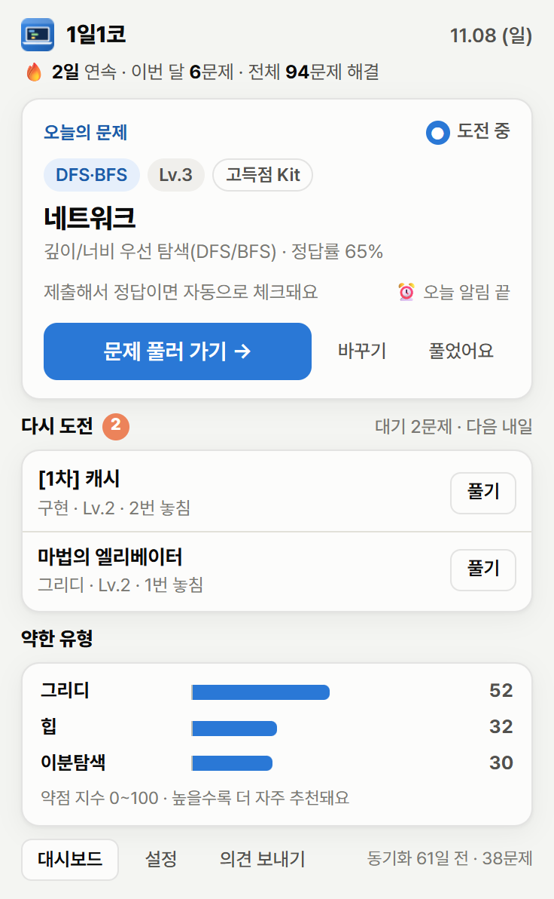
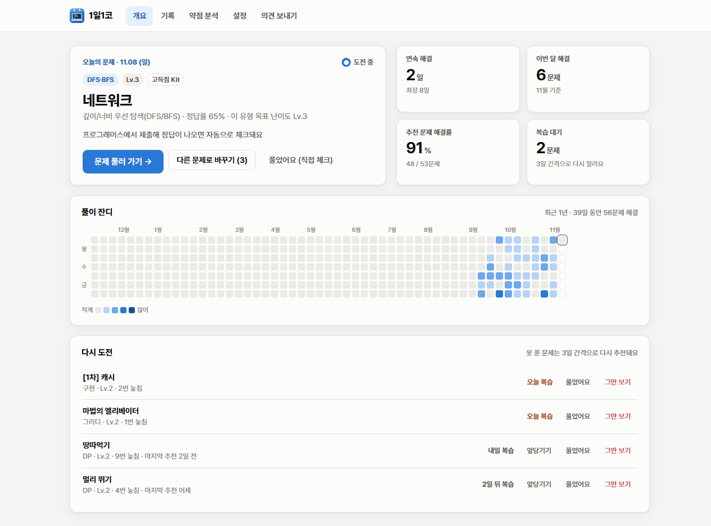
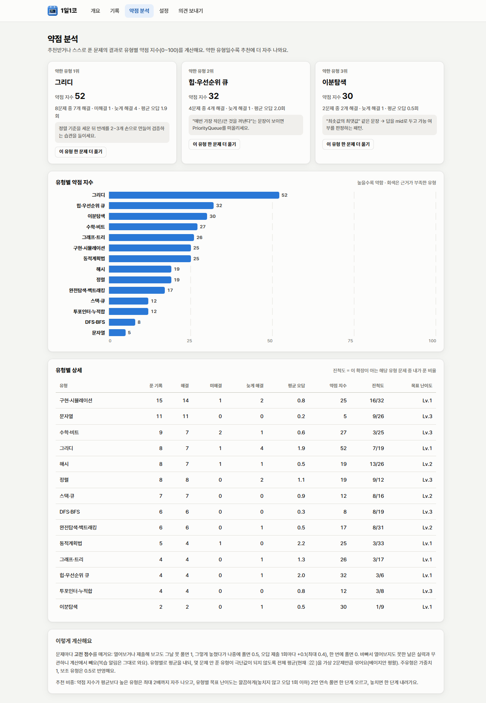

# 1일1코 - 하루에 알고리즘 하나

코딩테스트 단골 유형을 돌려가며 **매일 프로그래머스 문제 하나를 알림으로 추천**하고,
제출 결과를 **자동으로 감지**해 기록·복습·약점 분석까지 해 주는 크롬 확장 프로그램입니다.
서버 없이 설치만 하면 바로 동작합니다.

| 팝업 | 대시보드 |
| --- | --- |
|  |  |

> 스크린샷은 `npm run e2e` 가 실제 Chrome 에 확장을 올려 데모 기록(60일치)으로 찍은 화면입니다.

## 할 수 있는 것

| 원하던 것 | 이렇게 동작합니다 |
| --- | --- |
| 하루에 한 문제 추천 | 14개 코테 유형(구현·DFS/BFS·완전탐색·DP·그리디·문자열·해시·스택/큐·정렬·힙·이분탐색·그래프·투포인터·수학)을 **출제 비중대로 돌려가며** 279문제 카탈로그에서 하나를 고릅니다. 같은 조건이면 고득점 Kit → 카카오·PCCP 기출 → 연습문제 순. |
| 알림 | 정한 시각마다(기본 **10·14·17·20시**, 설정에서 추가·삭제) **같은 오늘의 문제**로 알림. 풀면 그날 남은 알림은 오지 않고, 알림의 **오늘은 그만 알림** 버튼, 툴바 아이콘 배지(남은 문제 수 / ✓). |
| 풀었는지 감지 | ① 문제 페이지에서 **제출 후 채점하기** 결과(“정답입니다!”/“틀렸습니다”, 합계 점수)를 자동 감지 ② 프로그래머스 **해결한 문제 목록** 동기화 ③ 팝업의 **풀었어요** 직접 체크. |
| 못 푼 문제는 며칠에 한 번 다시 | 추천받은 날 못 풀면 **N일(기본 3일) 뒤 복습으로 다시 추천·알림**, 풀 때까지 반복. 하루 복습 개수 제한, 앞당기기·그만 보기 가능. |
| 이전에 푼 문제 다시 보기 | 대시보드 **기록** 탭: 날짜·유형·난이도·상태·오답 수·풀이 시간, 검색·필터. 설치 전에 푼 문제도 가져와서 보여 줍니다. 1년치 **풀이 잔디**. |
| 사용자 의견 받기 | 대시보드 **의견 보내기** 탭(팝업에도 버튼): 종류(버그·기능 제안·기타)와 내용을 적으면 개발자 메일(gykim0330@naver.com)로 보내는 메일 앱이 열리고, 내용 복사·GitHub 이슈도 지원. `src/lib/feedback.js` 에 Web3Forms 키를 넣으면 확장 안에서 바로 전송. |
| 약한 유형 판단 | 유형별 **약점 지수(0~100)**, 약한 유형 TOP 3 + 공부 팁. 약한 유형은 **추천에 더 자주** 나오고, 유형별 목표 난이도도 자동 조절됩니다. |



## 설치 (2분)

1. [크롬 웹스토어](https://chromewebstore.google.com/search/1%EC%9D%BC1%EC%BD%94)에서 **1일1코**를 찾아 **Chrome에 추가**
2. 자동으로 열리는 환영 페이지에서 **알림 테스트**를 눌러 알림이 보이는지 확인
3. [프로그래머스](https://school.programmers.co.kr/learn/challenges)에 **로그인**해 두기
   → 이미 푼 문제를 가져와 추천에서 빼고, 다른 기기에서 푼 것도 확인합니다
4. 툴바의 퍼즐 아이콘에서 **1일1코**를 고정(📌)

> 소스에서 바로 쓰려면: `chrome://extensions` → 오른쪽 위 **개발자 모드** 켜기 → **압축해제된 확장 프로그램을 로드합니다** → 이 폴더(`programmers-daily`) 선택.
> 스토어 버전과 함께 켜 두면 서로 다른 확장으로 취급돼 알림이 두 번 옵니다.

**알림이 안 보이면**
- Windows 설정 → 시스템 → 알림 에서 **Google Chrome** 허용, 방해 금지(집중 모드) 해제
- 알림은 크롬이 켜져 있어야 옵니다. 크롬 설정 → 시스템 → *Google Chrome을 닫았을 때 백그라운드 앱 계속 실행* 을 켜 두면 좋습니다.
  크롬을 늦게 켜도 켜는 순간 그날 알림이 옵니다(놓친 날은 자정 넘김 처리로 복습에 들어갑니다).

## 하루 흐름

```
10:00  🔔 "오늘의 코테 · 해시 Lv.2 — 전화번호 목록"  [문제 풀러 가기] [오늘은 그만 알림]
       (복습할 문제가 있으면 같은 알림에 "다시 도전 1문제도 있어요")
  ↓  문제 페이지를 열면 "📌 오늘의 추천 문제예요" 안내
  ↓  제출 후 채점하기 → "틀렸습니다" → 오답 1회 기록
  ↓  다시 제출 → "정답입니다!" → ✅ "오늘의 문제 해결! 🔥 4일 연속"  (배지 ✓)
14:00  (못 풀었으면) 🔔 "오늘 문제, 아직이에요" — 같은 문제, 17·20시에도 (풀면 멈춤)
00:00  못 푼 문제 → 복습 대기열 → 3일 뒤 다시 추천
```

## 풀었는지 어떻게 알아내나

1. **채점 결과 감지 (실시간)** — `school.programmers.co.kr` 문제 페이지에서 도는 content script 가
   결과 모달(`#modal-dialog`)의 “정답입니다 / 틀렸습니다”와 콘솔(`#output`)의 `합계: 100.0 / 100.0` 을 지켜봅니다.
   정답이면 해결, 오답이면 오답 수를 셉니다. 추천받지 않은 문제를 스스로 풀어도 기록됩니다.
2. **해결 목록 동기화 (보완)** — 프로그래머스 문제 목록 화면이 쓰는 API(`statuses[]=solved`)를 내 로그인 세션으로 조회합니다.
   6시간마다 + 프로그래머스 페이지를 열 때. 다른 기기에서 푼 문제, 감지를 놓친 경우를 메꿔 주고, 설치 전에 푼 문제를 추천에서 뺍니다.
3. **직접 체크** — 팝업·대시보드의 *풀었어요* / *되돌리기*.

풀이 코드는 읽거나 저장하지 않습니다.

## 데이터는 어디에

- 별도 DB 서버가 없습니다. 기록은 크롬에 내장된 확장 전용 저장소 `chrome.storage.local`(내부적으로 LevelDB 파일)에 저장되고,
  실제 파일은 각자 PC의 크롬 프로필 폴더(`Local Extension Settings\<확장 ID>`)에 있습니다. 외부 서버로 보내지 않습니다.
- 그래서 웹스토어로 여러 명이 설치해도 각자 자기 PC에 따로 저장되고, 서버 비용·운영이 필요 없습니다.
- 대시보드 → 설정 → **백업 내보내기 / 불러오기**(JSON)로 옮기거나 되살릴 수 있습니다.
- 확장을 삭제하면 기록도 지워지니, 지우기 전에 백업하세요.
- 여러 기기 동기화나 친구와 기록 공유가 필요해지면 그때 서버 DB(예: Supabase)를 붙입니다 — [설계 문서 10절](docs/DESIGN.md#10-다음-단계).

## 크롬 웹스토어 등록

등록에 필요한 자료는 `store/` 에 다 있습니다.

| 자료 | 위치 |
| --- | --- |
| 업로드할 zip | `npm run package` → `dist/coding-daily-<버전>.zip` |
| 등록 문구(요약·설명·권한 사유·개인정보 공개 항목) | [store/LISTING.md](store/LISTING.md) |
| 개인정보처리방침(공개 주소에 올려 링크 입력) | [store/PRIVACY.md](store/PRIVACY.md) |
| 스크린샷 1280×800 ×5 | `store/images/screenshots/` (이 폴더 5장만 스크린샷 칸에) |
| 스토어 아이콘 128×128, 작은 홍보 타일 440×280 | `store/images/` (`npm run icons`, `npm run store:assets` 로 다시 생성) |

개발자 등록(구글 계정, 일회성 등록비, 이메일 인증)과 제출 버튼은 본인이 직접 해야 합니다. 순서는 LISTING.md 0절에 있습니다.

## 설정할 수 있는 것

알림 켜고 끄기, 알림 시각(최대 6개), 난이도 범위(Lv.1~5), 시작 난이도, 복습 간격(일), 하루 복습 최대 수,
약점 맞춤 추천, 추천할 유형, 풀이 언어(문제를 열 때 에디터 언어), 자동 동기화.

## 개발

Node 20 이상(외부 패키지 없음).

```bash
npm test                    # 단위 테스트 28개: 추천·복습·약점·알림 스케줄(가짜 시계)·동기화
npm run e2e                 # 실제 Chrome 에 확장을 올려 25개 항목 점검 + docs/screenshots 갱신
npm run fetch:challenges    # 프로그래머스 전체 문제 목록 받기 (data/raw, git 제외)
npm run build:catalog       # 유형 태그 + 문제 목록 → src/data/problems.js (ID 검증 포함)
npm run package             # dist/coding-daily-<버전>.zip (웹스토어 업로드·공유용)
```

- 문제 유형을 고치거나 문제를 추가하려면 `data/catalog.source.mjs` 를 고치고 `build:catalog` 를 돌립니다. 없는 문제 ID는 빌드가 막습니다.
- `npm run e2e` 는 임시 프로필로 별도 Chrome 을 띄웁니다(평소 쓰는 프로필은 건드리지 않음). `--offline` 이면 프로그래머스 접속 검사를 건너뜁니다.
- 서비스 워커 콘솔에서 `self.codingDaily.tick()` · `self.codingDaily.syncSolved({ force: true })` 로 직접 돌려볼 수 있습니다.

```
manifest.json
src/
  background/   service-worker.js(진입점) · service.js(알람·알림·메시지·동기화)
  content/      programmers.js(문제 페이지: 열람·채점 결과 감지·동기화)
  lib/          engine.js(상태 전이) · recommender.js · analytics.js · state.js · store.js
                dates.js · topics.js · catalog.js · programmers.js · view.js
  popup/        팝업 화면
  dashboard/    대시보드(개요·기록·약점 분석·설정)
  ui/           공용 스타일·DOM 헬퍼
  data/         problems.js (생성물)
data/           catalog.source.mjs (유형 태그 원본)
dev/            scenario.mjs (데모 기록 생성)
scripts/        e2e · 카탈로그 빌드 · 아이콘 · 패키징
tests/          단위 테스트
docs/           DESIGN.md (설계) · screenshots/
```

설계 배경과 알고리즘은 **[docs/DESIGN.md](docs/DESIGN.md)** 에 정리했습니다.

## 알려진 한계

- 프로그래머스가 결과 화면 문구·구조를 바꾸면 실시간 감지가 멈출 수 있습니다. 그동안은 동기화·직접 체크가 대신하고, 고칠 곳은 `src/content/programmers.js` 한 파일입니다.
- 알림은 크롬이 실행 중일 때만 옵니다.
- 기록은 브라우저(프로필)마다 따로입니다. 여러 PC에서 쓰려면 백업 파일로 옮기세요.
- 2025 카카오 하반기·코드챌린지 본선 등 최신·고난도 일부는 유형을 확인하지 못해 카탈로그에서 뺐습니다(직접 풀면 '미분류'로 기록은 됩니다).
