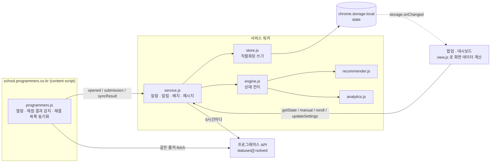

# 설계 문서 — 1일1코

## 1. 요구사항

| # | 요구 | 핵심 질문 |
| --- | --- | --- |
| R1 | 하루에 한 문제 추천, 코테 단골 유형을 돌려가며 | 유형은 무엇이고, 어떻게 '돌리나'? 문제 ID와 유형은 어디서? |
| R2 | 알림 | 크롬이 언제 켜져 있을지 모르는데 '매일 9시'를 어떻게 지키나? |
| R3 | 풀었는지/못 풀었는지 감지 | 프로그래머스는 공개 API·웹훅이 없다 |
| R4 | 못 푼 문제는 며칠에 한 번 다시 알림 | '못 풂'의 기준 시점은? 몇 번까지? |
| R5 | 이전 기록 확인 | 무엇을 남겨야 나중에 의미 있나? |
| R6 | 약한 유형 판단 | 몇 문제 안 풀었을 때 과장되지 않게? 판단을 어디에 쓰나? |

## 2. 핵심 결정과 이유

### 2-1. 서버 없이 브라우저 안의 DB(chrome.storage.local)부터

처음 아이디어는 "DB에 저장 + 구독"이었지만, 1단계는 **서버 없는 로컬 우선**으로 갔다.

- 기능 6개가 전부 **한 사람의 브라우저 안에서** 끝난다. 추천·알림·감지·분석 모두 서버가 필요 없다.
- 서버를 두면 계정·인증·배포·운영비가 생기고, 무엇보다 **서버가 꺼져 있으면 알림이 안 온다.**
- '구독'은 **확장 설치 = 구독**으로 대체된다. 웹스토어에 올리면 누구나 설치만으로 자기만의 추천을 받는다.
- 저장소 계층(`store.js`)은 `{get, set}` 인터페이스 하나로 감싸 두어, 여러 기기 동기화가 필요해지면
  같은 상태(JSON)를 서버(Spring/Supabase 등)에 올리는 구현으로 바꿀 수 있다.

`chrome.storage.local` 을 고른 이유: 서비스 워커·팝업·대시보드 어디서나 읽을 수 있고, 10MB(1년 써도 수백 KB)면 충분하다.
IndexedDB 는 질의가 강하지만 이 규모에선 이득이 없고, `storage.sync` 는 8KB/항목 제한이라 기록이 넘친다.

### 2-2. 감지는 한 가지 방법에 기대지 않는다(3중)

프로그래머스는 '제출 결과'를 외부에 알려 주는 공식 수단이 없다. 그래서 성격이 다른 세 경로를 겹쳤다.

| 경로 | 장점 | 약점 | 역할 |
| --- | --- | --- | --- |
| 채점 결과 DOM 감지 | 실시간, **오답 횟수·풀이 시간**까지 앎 | 화면 구조가 바뀌면 멈춤 | 주 경로 |
| 해결 목록 동기화(API) | 다른 기기·감지 누락도 잡음, 설치 전 기록까지 | 오답 횟수 모름, 6시간 주기 | 보완 |
| 직접 체크 | 언제나 동작 | 사람이 눌러야 함 | 비상구 |

DOM 감지 근거(2026-11 실제 페이지 확인): 문제 페이지의 `.lesson-content` 에 `data-lesson-id`, `data-lesson-title`,
`data-challenge-level`, `data-user-signed-in` 이 있고, 결과는 빈 `#modal-dialog` 에 채워진다. 콘솔은 `#output`.
감지는 ① 모달의 "정답입니다/틀렸습니다", ② 제출 버튼을 누른 뒤 콘솔의 `합계: X / Y` 두 신호를 쓰고,
같은 제출을 두 번 세지 않도록 판정이 바뀔 때만(래치) + 10초 중복 제거로 한 번만 기록한다.
E2E 테스트가 실제 프로그래머스 페이지에 결과 모달을 그려 넣어 이 경로를 검증한다.

API 근거: 문제 목록 화면이 쓰는 `GET /api/v2/school/challenges/?perPage=100&page=N&statuses[]=solved` 는
로그인 세션 기준으로 해결한 문제만 돌려준다(비로그인은 0건). 0건이면 문제 페이지의 `data-user-signed-in` 으로 로그인 여부를 확인해 안내한다.
해결은 되돌아가지 않으므로 **합집합만** 한다(빈 응답이 기존 기록을 지우지 않음).

### 2-3. 알림은 '정확한 알람 + 30분 안전망 + 멱등 처리'

크롬 알람은 컴퓨터가 잠들어 있으면 늦게 울리고, MV3 서비스 워커는 수시로 꺼진다. 그래서

- 시각 알람 4개: `daily`(아침), `remind`(저녁), `midnight`(00:01 날짜 넘김), `tick`(30분마다 안전망)
- 모든 알람은 같은 `tick()` 을 부르고, `tick()` 은 **멱등**이다: 날짜 넘김 처리 → 오늘 추천 보장 →
  `notificationPlan()` 으로 "지금 보낼 알림"을 계산 → 보낸 시각을 기록해 같은 날 같은 알림은 한 번만.
- 크롬을 늦게 켜면(예: 22시) 아침 알림만 보내고 저녁 알림은 생략한다.

### 2-4. '놓침'은 그날 열어보거나 제출해 본 경우만 약점 근거로

데모 데이터를 돌려 보다 발견한 문제: 바빠서 문제를 **열어보지도 못한 날**까지 약점으로 세면,
그 유형의 약점 지수가 오르고 난이도가 내려가는 엉뚱한 학습이 일어난다.
그래서 `missCount`(복습 예약용)와 `triedMisses`(그날 열어봤거나 제출해 보고도 못 푼 횟수, 약점 근거)를 나눴다.
복습 알림은 둘 다 받지만, 약점·난이도 조절에는 `triedMisses` 만 쓴다.

## 3. 구조



- **쓰기는 서비스 워커 한 곳**에서만, `store.update()` 가 요청을 한 줄로 세워 처리한다(탭 여러 개에서 동시에 정답이 와도 유실 없음).
- 도메인 로직(`lib/`)은 chrome API 를 모르는 **순수 함수**라 Node 에서 그대로 테스트한다. `service.js` 도 chrome·시계·fetch 를 주입받는다.
- 화면은 저장소 변경 이벤트를 구독해, 다른 탭에서 정답을 내면 열려 있는 팝업·대시보드가 바로 갱신된다.

## 4. 데이터 모델 (`state` 한 덩어리)

```js
{
  schemaVersion: 1,
  settings: { notifyTime, reminderTime, retryIntervalDays, maxReviewsPerDay, minLevel, maxLevel, startLevel,
              topics[], adaptive, language, autoSync, enabled, reminderEnabled },
  records: {            // 문제 ID → 풀이 기록
    42577: { id, title, level, topics, part, origin: 'daily'|'self',
             status: 'pending'|'solved'|'missed'|'dropped'|'tracked',
             recTopic, recommendedOn: ['2026-11-08', ...], firstOpenedAt, lastOpenedAt,
             submits, wrong, lastSubmitAt, solvedAt, solvedOn, solvedVia: 'detect'|'sync'|'manual',
             missCount, triedMisses, nextReviewOn }
  },
  days: {               // 날짜 → 그날의 추천
    '2026-11-08': { problemId, topic, targetLevel, reviewIds: [], notifiedAt, remindedAt, rerolls, closed }
  },
  events: [ { t, d, id, type: 'recommend'|'pass'|'fail'|'solve'|'miss'|'skip'|... } ],  // 최근 3000개
  rotation: { current: { impl: -5, dp: 3, ... } },   // 가중 라운드로빈 상태
  topicLevel: { dp: { level: 2, streak: 1 } },        // 유형별 난이도 계단
  solvedSync: { ids: [], meta: {}, at, attemptAt, ok, signedIn, message },
  skipped: {}, opens: {}, meta: { installedAt, lastTickAt }
}
```

상태 전이(`engine.js`):

```
             추천(아침)                   정답 감지·동기화·직접 체크
  (없음) ───────────────▶ pending ─────────────────────────────▶ solved
                            │  ▲
          그날 못 풂(자정)  │  │ nextReviewOn 도래 → 복습으로 다시 추천
                            ▼  │
                          missed ──── 그만 보기 ───▶ dropped
```

## 5. 추천 알고리즘 (`recommender.js`)

**① 유형 고르기 — 가중 라운드로빈(Smooth Weighted Round-Robin)**

- 유형별 기본 비중: 구현·DFS/BFS 3, 완전탐색·DP·그리디·문자열·해시·스택/큐 2, 정렬·힙·이분탐색·그래프·투포인터·수학 1 (합 24).
  카카오·네이버·삼성류 코테에서 구현/시뮬레이션과 탐색이 가장 많이 나온다는 점을 반영했다.
- 매일 각 유형의 누적값에 비중을 더하고, 가장 큰 유형을 고른 뒤 그 유형에서 비중 합을 뺀다.
  → 24일이면 비중만큼 정확히 나오고(구현 3번, 수학 1번), 같은 유형이 몰리지 않는다(테스트로 검증).
- **약점 맞춤**: 실효 비중 = 기본 비중 × (1 + 가산치). 가산치 = (유형 약점 − 전체 평균) × 2 × 신뢰도, 0~1.
  약한 유형은 최대 2배까지 자주 나온다.

**② 문제 고르기** — 그 유형 문제 중 이미 푼 것·복습 대기·그만 본 것·최근 30일 안에 넘긴 것을 빼고,
점수 `|레벨 − 목표 난이도| × 10 + (보조 유형이면 4) + 출처 등급 × 2` 가 가장 낮은 문제들 중 하나(같은 날이면 같은 결과가 나오는 시드 난수).
출처 등급: 고득점 Kit 0 · 기업/PCCP 기출 1 · 연습문제 2. 설정 범위를 다 풀면 범위를 넓혀서라도 추천한다.

**③ 난이도 계단** — 유형마다 목표 난이도를 따로 둔다(시작 Lv.2). 깔끔하게(놓친 적 없이, 오답 1회 이하) 2번 연속 풀면 +1,
열어보고도 놓치면 −1. '2-up/1-down' 계단은 대략 70% 안팎으로 풀리는 난이도에 머물러, 너무 쉽지도 어렵지도 않게 유지된다.

**④ 다른 문제로 바꾸기** — 같은 유형 안에서 하루 3번까지. 넘긴 문제는 30일 동안 다시 안 나온다.

## 6. 복습(재알림) 스케줄

- 추천일(그날 자정)까지 못 풀면 `missed`, `nextReviewOn = 추천일 + 간격(기본 3일)`.
- 그날이 오면 새 문제와 **별도로** 복습 문제가 추천된다(하루 최대 2개, 오래 기다린 것부터). 알림도 따로 간다.
- 복습 날에도 못 풀면 다시 `+간격`. 풀 때까지 반복하고, 그만 보기로 뺄 수 있다.
- 크롬을 며칠 안 켜도 밀린 날짜를 한 번에 처리하고, 기한이 지난 복습은 다음에 켠 날 바로 올라온다.
- 간격을 고정(N일)으로 둔 건 "며칠에 한 번 다시"라는 요구 그대로이고, 설정에서 1~30일로 바꿀 수 있다.

## 7. 약점 분석 (`analytics.js`)

문제마다 **고전 점수** s ∈ [0, 1]:

| 상황 | s |
| --- | --- |
| 한 번에 정답 | 0 |
| 오답 제출 k회 후 정답 | 0.1 × min(k, 4) |
| 열어보고/제출해 보고도 그날 못 풀었다가 나중에 정답 | 0.5 + 오답 가산 |
| 열어보고도 못 풀고 아직 미해결, 그만 보기 | 1 |
| 열어보지도 않은 놓침, 오늘 막 추천됨 | 판단 보류(제외) |

유형 t 의 약점 = **(Σ wᵢ·sᵢ + K·p) / (Σ wᵢ + K)**
- wᵢ: 주유형 1, 보조 유형 0.5 (예: 순위 검색 = 해시 1, 이분탐색 0.5)
- p: 전체 평균 고전 점수(3문제 미만이면 0.35), K = 2 — **베이지안 평활**.
  1문제 틀렸다고 약점 100이 되지 않고, 근거가 쌓일수록 실제 값으로 다가간다.
- 신뢰도 = Σw / (Σw + K). 근거가 1.5 미만인 유형은 순위에서 빼고 '데이터 부족'으로 표시한다.
- 함께 보여 주는 것: 해결/미해결/늦게 해결 수, 평균 오답, 평균 풀이 시간(처음 연 시각 → 정답 시각),
  카탈로그 진척도(이 유형 문제 중 푼 비율), 유형별 목표 난이도.

## 8. 문제 카탈로그

- 출처: 프로그래머스 공개 문제 목록 API(689문제) → SQL·Lv.0(입문/기초)·문법 연습 수준 Lv.1·내용을 확인 못 한 최신 문제 제외 → **279문제**.
- 유형 태그는 사람이 붙인다(`data/catalog.source.mjs`, 주유형 + 보조유형). 프로그래머스는 기출 문제에 알고리즘 태그를 주지 않기 때문.
- `build-catalog.mjs` 가 태그한 ID를 실제 목록과 대조해 **없는 ID면 빌드를 실패**시키고, 제목·레벨·정답률은 API 값으로 채운다.

## 9. 테스트

| 층 | 무엇을 | 어떻게 |
| --- | --- | --- |
| 도메인 | 추천 회전·필터·계단, 놓침→복습 주기, 밀린 날짜 처리, 오답 집계, 동기화 합집합, 약점 순위, 알림 계획, 저장소 동시 쓰기 | `node --test` (tests/engine.test.mjs) |
| 서비스 | 설치→9시 알림→21시 리마인더→정답 후 배지, 자정 놓침→3일 뒤 복습 알림, 스누즈, 첫 동기화 시 이미 푼 문제 교체, 6시간 주기 | 가짜 chrome·가짜 시계 (tests/service.test.mjs) |
| E2E | 실제 Chrome 156 에 확장 로드, 서비스 워커, 알람·알림·배지, **실제 프로그래머스 문제 페이지**에서 열람·오답·정답·콘솔 점수 감지, API 동기화, 팝업·대시보드 렌더, 설정 저장 | `npm run e2e` — CDP(`Extensions.loadUnpacked`) |

## 10. 다음 단계

1. **크롬 웹스토어 등록** — `npm run package` 의 zip 을 그대로 올리면 된다(개인정보 처리: 외부 전송 없음).
2. **여러 기기 동기화** — `store.js` 아래에 서버 저장소를 붙인다. 상태가 JSON 한 덩어리라 '마지막 수정 우선 + 레코드 단위 병합'으로 충분하다.
3. **같이 풀기** — 서버가 생기면 스터디원끼리 같은 날 같은 문제, 해결 현황 공유.
4. **풀이 코드 보관** — 정답 시점 에디터 코드를 GitHub 에 커밋(백준허브 방식). 지금은 의도적으로 코드를 읽지 않는다.
5. **간격 늘리기 복습** — 지금은 고정 N일. 해결한 문제를 1→3→7→14일로 다시 보여 주는 간격 반복(SM-2)으로 확장 가능.
